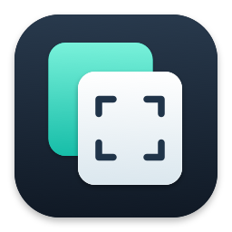
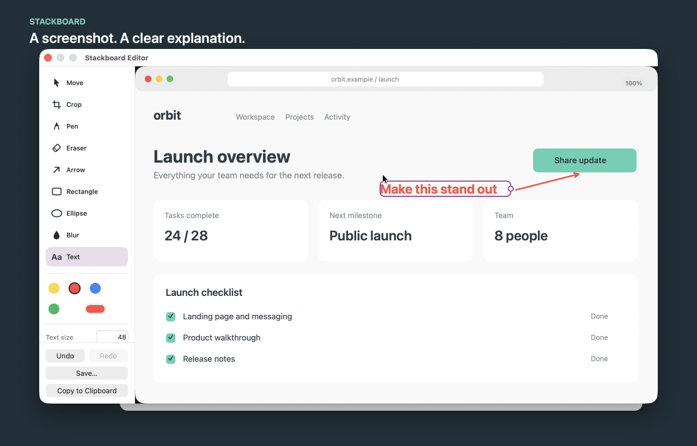

<p align="center">
  
</p>

<h1 align="center">Stackboard</h1>

<p align="center"><strong>Screenshots, annotations, and clipboard history for macOS.</strong></p>

<p align="center">
  Capture a region, add arrows and notes, then copy or save the result.<br>
  Need something you copied earlier? Find it in your clipboard history.
</p>

<p align="center">
  <a href="https://github.com/0x0FACED/stackboard/releases/latest"><strong>Download for macOS</strong></a> ·
  <a href="#install">Install with Homebrew</a> ·
  <a href="docs/guide.md">User guide</a>
</p>

<p align="center">macOS 13.5+ · Apple Silicon &amp; Intel · Lives in your menu bar</p>



<p align="center">
  <em>Capture it. Make your point. Share the result.</em><br>
  <a href="docs/media/stackboard-editor.png">Still preview</a> ·
  <a href="docs/media/stackboard-demo.mp4">Watch as video</a>
</p>

## A screenshot that explains itself

Point out a UI issue, mark up a design, or show someone exactly where to click.

- **Make your point.** Add arrows, freehand drawings, text, rectangles, and ellipses. Choose your colors, line widths, and fonts.
- **Keep editing.** Move and resize annotations, edit your text, erase your marks, or undo and redo changes. Each editor window has its own history.
- **Get the framing right.** Crop after capture without flattening your annotations. Keep the original image resolution when you copy or export.
- **Start with an existing image.** Open a file or image from the clipboard and use the same editing tools. The source file stays unchanged unless you explicitly save over it.
- **Take the result anywhere.** Copy the finished image to paste into another app, or save it as PNG or JPEG. Saving keeps the editor open; copying closes it.

## Your clipboard, a few copies later

That link, snippet, or image you copied is still within reach.

Press **`⌘⇧V`** to open clipboard history. Search your copied text and file references, preview an entry, and choose **Copy Again**. Then paste it wherever you need it with `⌘V`.

Pin entries you want to keep, choose an automatic cleanup period, or grab one of the eight most recent items straight from the menu bar. History is stored locally on your Mac and survives app restarts, with no cloud sync.

> Clipboard history can include passwords and other sensitive text. Stackboard does not currently filter private clipboard markers or offer per-app exclusions or a recording pause. See [Privacy and storage](docs/guide.md#privacy-and-storage) before using it with sensitive content.

## Install

Requires **macOS 13.5 or later**. The release is a **Universal app** for Apple Silicon and Intel Macs.

### Homebrew

With [Homebrew](https://brew.sh) installed:

```sh
brew install --cask 0x0faced/stackboard/stackboard
open /Applications/Stackboard.app
```

### Direct download

Download **`Stackboard.zip`** from the [latest release](https://github.com/0x0FACED/stackboard/releases/latest), extract it, and move **Stackboard.app** to **Applications**. Open the app and look for its icon in the menu bar.

You can [verify the download with SHA-256](docs/guide.md#install-manually-and-verify-the-download) using the release's `SHA256SUMS` file.

> **First launch:** releases are ad-hoc signed, without Developer ID signing or Apple notarization. macOS may block the app, including when installed through Homebrew. After trying to open it, go to **System Settings → Privacy & Security → Open Anyway**, if available and you trust the download. Do not disable Gatekeeper. [First-launch help →](docs/guide.md#first-launch)

To take screenshots, allow **Screen Recording** in **System Settings → Privacy & Security** when prompted. Restart Stackboard if macOS asks. This permission is not needed for clipboard history or editing existing images.

## Your first screenshot

1. Press **`⌘⇧S`** and drag to select an area of your screen.
2. Add an arrow, a note, or a shape using the editor's left sidebar.
3. Choose **Copy to Clipboard** and paste the image into your message, issue, or document. Prefer a file? Choose **Save…** or press `⌘S`.

You can open another screenshot without closing the previous editor.

### Handy shortcuts

| Action | Shortcut |
| --- | --- |
| Capture a screen region | `⌘⇧S` |
| Open clipboard history | `⌘⇧V` |
| Open an image file, while Stackboard is active | `⌘O` |
| Save from the editor | `⌘S` |
| Undo / Redo | `⌘Z` / `⌘⇧Z` |

The capture and history shortcuts work globally. Change them in **Keyboard Shortcuts…** from the Stackboard menu if they conflict with another app.

## A few things to know

- **Keep important results.** Save or copy an image before closing its editor. PNG and JPEG exports are finished images, not editable Stackboard documents.
- **Blur is not secure redaction.** Do not rely on blur to remove secrets from an image.
- **History is not a backup.** File entries retain paths, not copies of the files. Automatic cleanup defaults to 30 days; pins are excluded from automatic cleanup, but **Clear History** removes them too. An entry-count limit still applies when age-based cleanup is off.

## Help and feedback

- [User guide](docs/guide.md) — editor tools, image formats, clipboard history, and data storage.
- [Troubleshooting](docs/guide.md#troubleshooting) — first launch, permissions, Homebrew trust, and shortcut conflicts.
- [Updates and uninstalling](docs/guide.md#update).
- [Report a bug or suggest an improvement](https://github.com/0x0FACED/stackboard/issues). Include your Stackboard version, macOS version, and steps to reproduce. Keep private clipboard contents and screenshots out of bug reports.

---

Looking for the source? [Build and development guide](docs/development.md) · [Maintainer release guide](docs/releases.md)
